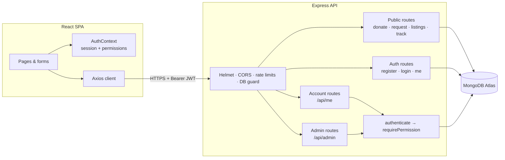
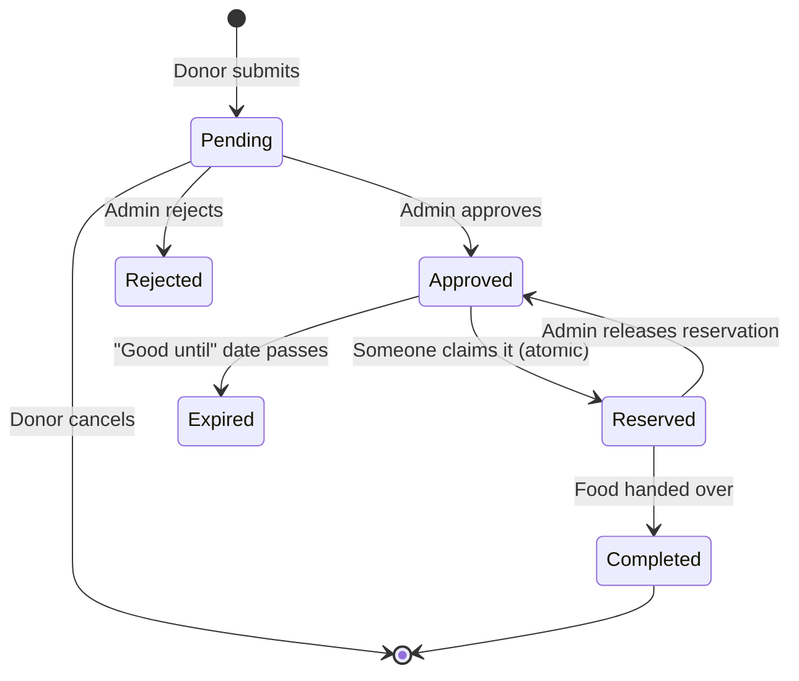

<div align="center">

# 🌿 NourishNet

**A full-stack food rescue platform that connects surplus food with people who need it.**

Donors list surplus food, people in need find and reserve it, and a team of admins keeps everything safe and coordinated, with every step trackable end to end.


</div>

---

## 📌 The problem

Large amounts of edible food are thrown away every day by households, restaurants and stores, while many people nearby struggle to put a meal on the table. The gap isn't the food. It's **coordination**:

- Donors don't know who needs food *right now*, or how to hand it over safely.
- People in need have no easy, dignified way to find what's available near them.
- Food banks juggle calls, spreadsheets and messages, with no single view of what's pending, approved or delivered.

## 💡 The solution

NourishNet turns that coordination problem into a simple, transparent workflow:

1. **Donors** describe what they have (food type, diet, quantity, pickup area, "good until" date) in a guided four-step form.
2. **The team reviews** every donation before it goes public, so only safe, approved food is listed.
3. **People in need** browse live listings by city, food type and diet, and **reserve** food in one click, or submit a general food request.
4. **Everyone gets a tracking code** to follow their donation or request from *Received* → *Approved* → *Completed*, with notes from the team.
5. **Admins** run everything from one dashboard: review, approve, coordinate, export and manage users.

---

## ✨ Key features

### For donors and people in need
- 🥕 **Guided donation wizard** with step-by-step validation and a review screen before submitting
- 🔎 **Find Food**: live listings filtered by city, food type and diet (veg / non-veg / vegan)
- ⚡ **One-click reservation** that is **race-safe**: two people can never claim the same food
- 📦 **Order tracking** with a tracking code and email, showing a status timeline and team notes
- 👤 **Optional accounts**: sign up to see all your donations and requests in one place and cancel pending ones; anonymous use still works
- 🙋 **Volunteer sign-up**, contact form, newsletter and a UPI QR code for money donations
- 📊 **Live impact numbers** on the home page (kg shared, donations, requests fulfilled, volunteers)

### For the team (admin dashboard)
- 📈 Overview stats and a **14-day trend chart** of requests vs. donations
- 🗂️ Tabs for **Requests, Donations, Messages, Volunteers, Subscribers and Users**, with search, status filters, sorting and pagination
- ✅ One-click status changes, **notes visible to the submitter** on the tracking page, and release of reservations
- 🔗 Linked records: see which request reserved which donation, and which account submitted what
- 📤 **CSV export** of any view (protected against spreadsheet formula injection)
- 👥 **User management**: promote or demote admins, suspend or delete accounts, with changes taking effect immediately

---

## 🛠️ Tech stack

| Layer | Technologies |
|---|---|
| **Frontend** | React 18, React Router 6, Axios, custom hooks (`useForm`), Context API, Font Awesome, hand-written responsive CSS |
| **Backend** | Node.js, Express 4, Mongoose 8 |
| **Database** | MongoDB Atlas |
| **Auth & security** | JWT (HS256), bcrypt, role-based access control, Helmet, CORS allow-list, express-rate-limit |
| **Testing** | Node's built-in `node:test` + Supertest (API integration), Jest + React Testing Library (UI) |
| **Deployment** | Render (API), MongoDB Atlas (database) |

---

## 🏗️ Architecture



### How a donation flows through the system



Only **approved, unreserved and unexpired** donations are public, and public listings never expose the donor's name, contact details or address.

---

## 🔐 Security & access control

NourishNet uses **role-based access control** with explicit, least-privilege permissions defined in one place ([`backend/rbac.js`](backend/rbac.js)). Routes check *permissions*, never role names.

| Permission | User | Admin |
|---|:-:|:-:|
| Manage own profile and password | ✅ | ✅ |
| View own donations and requests | ✅ | ✅ |
| Cancel own *pending* submissions | ✅ | ✅ |
| Dashboard stats and trends | | ✅ |
| Read / update / delete / export all records | | ✅ |
| Manage users and roles | | ✅ |

Highlights:
- **Correct HTTP semantics**: `401` when not signed in, `403` when not allowed, `404` for other people's records (ownership is enforced *inside the database query*, so records can't be probed).
- **No privilege escalation**: self-registration always creates a `user`, roles in request bodies are ignored, and admins can't demote themselves or remove the last admin.
- **Live role checks**: role and status are read from the database on each request, so a promotion or suspension applies instantly; password changes revoke other sessions.
- **Hardened inputs**: whitelisted, type-coerced validation blocks NoSQL injection; regex search terms are escaped; request bodies are size-limited.
- **Abuse protection**: separate rate limits for logins, sign-ups, form submissions and tracking lookups.
- **Privacy by design**: tracking requires *both* the code and the email; timing-safe login avoids revealing which emails exist.
- **Resilient startup**: if the database is unreachable, the API stays up, reports `degraded` on `/api/health`, answers `503` immediately instead of hanging, and retries with clear diagnostics.

---

## 🧩 Engineering highlights

- **Atomic reservations.** Claiming a listing uses a single conditional `findOneAndUpdate`, so concurrent claims resolve to exactly one winner (`200`) and one `409`. If saving the linked request fails, the reservation is rolled back.
- **Backward-compatible data.** Records created before statuses or tracking codes existed are handled transparently: they filter as `pending` and get tracking codes backfilled on startup.
- **Generic, config-driven admin API.** One set of list/search/filter/export/update handlers serves five collections from a small config map, which keeps the dashboard consistent and the code compact.
- **Shared validation rules.** Client-side validators mirror the server's rules for instant feedback, while the server stays the source of truth.
- **Tested end to end.** Integration tests cover validation, injection attempts, tracking, listings, concurrent claims, CSV safety, RBAC (401/403/404 paths), role changes and session revocation.

---

## 📁 Project structure

```
NourishNet/
├── backend/
│   ├── index.js            # Startup: DB connection with retry, backfills, role report
│   ├── app.js              # Express app: security middleware and route mounting
│   ├── auth.js             # Register, login, JWT verification, session resolution
│   ├── rbac.js             # Roles → permissions, requirePermission middleware
│   ├── generate.js         # CLI: generate SECRET_KEY, promote a user to admin
│   ├── models/             # Mongoose models: User, FoodDonation, FoodRequest, Volunteer, …
│   ├── routes/
│   │   ├── public.js       # Donate, request, listings, claim, track, impact, health
│   │   ├── account.js      # /api/me: own profile and submissions
│   │   └── admin.js        # /api/admin: dashboard, records, users, CSV export
│   ├── utils/validate.js   # Dependency-free input validation
│   └── tests/api.test.js   # API integration tests
└── frontend/
    └── src/
        ├── App.js          # Routes and permission-gated pages
        ├── api.js          # Axios client, token handling, error normalisation
        ├── Admin/          # Login, Dashboard, TrendChart
        ├── components/     # AuthContext, forms, modal, toast, listing card, validators
        └── *.js            # Home, FindFood, DonateFood, Requestform, TrackStatus, Account, …
```

---

## 🚀 Getting started

### Prerequisites
- Node.js 18+
- A MongoDB database (local, or a free MongoDB Atlas cluster)

### 1. Backend

```bash
cd backend
npm install
node generate.js            # prints a random SECRET_KEY
```

Create `backend/.env`:

```env
MONGO_URL=mongodb+srv://<user>:<password>@<cluster>/?retryWrites=true&w=majority
SECRET_KEY=<output of node generate.js>
CLIENT_ORIGIN=http://localhost:3000
PORT=8087
```

```bash
npm run dev                 # starts the API with nodemon on http://localhost:8087
```

### 2. Frontend

```bash
cd frontend
npm install
echo REACT_APP_API_URL=http://localhost:8087 > .env.local
npm start                   # opens http://localhost:3000
```

### 3. Create an admin

Register an account on the site, then promote it:

```bash
cd backend
node generate.js promote you@example.com
```

Sign in, and the **Dashboard** appears in the navigation. From there, admins can promote other users from the **Users** tab.

### Running the tests

```bash
# Backend: needs a local, disposable MongoDB (the test database is dropped)
cd backend && TEST_MONGO_URL=mongodb://127.0.0.1:27017/nourishnet_test npm test

# Frontend
cd frontend && npm test
```

---


## ☁️ Deployment (Render + Netlify + MongoDB Atlas)

1. **MongoDB Atlas:** Configured the database and network access for the deployed backend.
2. **Backend Deployment (Render):** Deployed the backend as a Web Service using the `backend` directory, with `npm install` as the build command and `npm start` as the start command.
3. **Environment Variables:** Configured the required backend environment variables in Render, including `MONGO_URL`, `SECRET_KEY`, and `CLIENT_ORIGIN`.
4. **Frontend Configuration:** Updated the frontend code to use the deployed Render backend URL for API requests.
5. **Frontend Deployment (Netlify):** Connected the GitHub repository to Netlify, configured the frontend build settings, and built and deployed the React application.
6. **Live Application:** The Netlify-hosted frontend communicates with the Render backend, which connects to MongoDB Atlas for data storage.
---

<details>
<summary><b>📚 API reference</b></summary>

<br/>

**Public** (sign-in optional; when signed in, submissions are linked to your account)

| Method | Endpoint | Description |
|---|---|---|
| `POST` | `/api/donate-food` | Submit a donation → returns a `DON-…` tracking code |
| `POST` | `/api/request-food` | Submit a food request → returns a `REQ-…` tracking code |
| `GET` | `/api/listings` | Approved, unreserved, unexpired donations (`city`, `foodType`, `dietType`); no personal data |
| `POST` | `/api/listings/:id/claim` | Atomically reserve a listing (`409` if already taken) |
| `POST` | `/api/track` | Status lookup with `{ trackingId, email }` |
| `GET` | `/api/impact` | Aggregate impact numbers (cached) |
| `POST` | `/api/volunteers`, `/api/contact`, `/api/connections` | Volunteer sign-up, contact form, newsletter |
| `GET` | `/api/health` | API and database status |

**Auth**

| Method | Endpoint | Description |
|---|---|---|
| `POST` | `/api/auth/register` | Create an account (always role `user`) |
| `POST` | `/api/auth/login` | Returns a JWT plus `user.role` and `user.permissions` |
| `GET` | `/api/auth/me` | The current session |

**Account** (`Authorization: Bearer <token>`)

| Method | Endpoint | Description |
|---|---|---|
| `GET` / `PATCH` | `/api/me` | View or update profile (name, phone, city) |
| `POST` | `/api/me/password` | Change password (signs out other sessions) |
| `GET` | `/api/me/donations`, `/api/me/requests` | Your own submissions |
| `DELETE` | `/api/me/:type/:id` | Cancel your own pending submission |

**Admin** (`Authorization: Bearer <token>` with admin permissions)

| Method | Endpoint | Description |
|---|---|---|
| `GET` | `/api/admin/stats` | Totals and 14-day trend |
| `GET` | `/api/admin/:type` | List with `q`, `status`, `sort`, `page`, `limit` |
| `GET` | `/api/admin/:type/export` | CSV export |
| `PATCH` | `/api/admin/:type/:id` | Update `status`, `adminNote`, or `releaseClaim` |
| `DELETE` | `/api/admin/:type/:id` | Delete a record |
| `GET` / `PATCH` / `DELETE` | `/api/admin/users[/:id]` | List, change `role` / `status`, or delete users |

`:type` is one of `requests`, `donations`, `contacts`, `volunteers`, `connections`.

</details>

---

## 🗺️ Roadmap

- Email notifications when a donation is approved or reserved
- Map view of listings with distance-based search
- Volunteer pickup assignment and route planning
- Image uploads for donations

---

<div align="center">

Built by [**@bhoomikaaa20**](https://github.com/bhoomikaaa20). Feedback and contributions are welcome!

</div>
